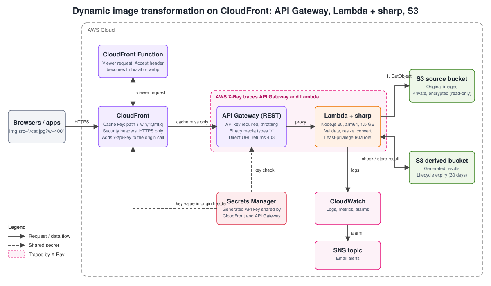
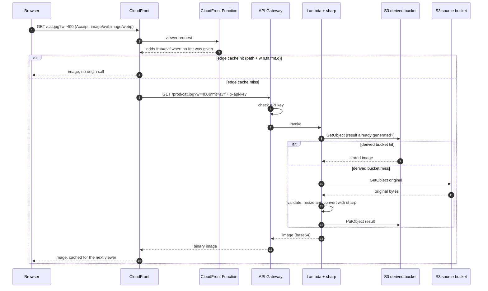

# Dynamic Image Transformation on Amazon CloudFront

Resize, crop and convert images **on the fly** from a URL, with the result cached at the edge. Upload one original image to S3, then request any size or format you need:

```
https://<distribution>.cloudfront.net/photos/cat.jpg?w=400&h=300&fit=cover&fmt=webp&q=75
```

The pattern is the same as the AWS Solutions Library reference solution [Dynamic Image Transformation for Amazon CloudFront](https://github.com/aws-solutions/dynamic-image-transformation-for-amazon-cloudfront) (CloudFront, API Gateway, Lambda and the sharp library). This repository is an independent, smaller implementation written for learning: it does not reuse that project's code.

> AWS Solutions Architect Associate (SAA-C03) graduation project. A variant of Project 2, with an on-demand design instead of a queue-driven pipeline.



## Contents

1. [Why this design](#why-this-design)
2. [How a request flows](#how-a-request-flows)
3. [AWS services and their role](#aws-services-and-their-role)
4. [URL reference](#url-reference)
5. [Key design decisions](#key-design-decisions)
6. [Repository layout](#repository-layout)
7. [Deploy](#deploy)
8. [Test it](#test-it)
9. [Cost](#cost)
10. [Clean up](#clean-up)
11. [Limitations and next steps](#limitations-and-next-steps)
12. [Learning outcomes covered](#learning-outcomes-covered)

## Why this design

Websites need the same picture in many sizes and formats (thumbnail, mobile, desktop, WebP, AVIF). Generating every variant in advance wastes storage and compute for sizes nobody requests. Here you store **one original** and create each variant **the first time it is asked for**. After that it is served from cache, so the compute cost is paid once per variant.

## How a request flows



There are **three cache levels**: the browser, the CloudFront edge, and the derived bucket. Only a miss at all three runs sharp.

## AWS services and their role

| Service | Role |
|---|---|
| **CloudFront** | Global CDN and the only public entry point. The cache key contains just the path and the five transformation parameters, so the cache hit ratio stays high. |
| **CloudFront Function** | Runs at the edge on every request. Reads the `Accept` header and sets `fmt=avif` or `fmt=webp` when the caller did not choose a format, so modern browsers get smaller files automatically. |
| **API Gateway (REST)** | Fronts Lambda. Requires an API key, applies throttling, and returns binary image bytes. |
| **Lambda (Node.js 20, arm64)** | Validates input, reads the original, transforms it with the sharp library, stores and returns the result. |
| **S3 source bucket** | Holds the original images. Private and encrypted. The function can only read it. |
| **S3 derived bucket** | Holds generated variants so they are never computed twice. A lifecycle rule deletes them after 30 days. |
| **Secrets Manager** | Generates the API key that CloudFront sends to API Gateway. Nobody types or stores it. |
| **IAM** | Read-only access to the source bucket, read/write to the derived bucket, nothing else. |
| **CloudWatch + SNS** | Log group with 14-day retention. Alarms on Lambda errors, slow p95 duration and API 5XX, with optional email. |
| **X-Ray** | Traces API Gateway and Lambda. |

## URL reference

`GET /<s3-key>?w=&h=&fit=&fmt=&q=` and `HEAD` are supported. Every parameter is optional.

| Parameter | Values | Default | Meaning |
|---|---|---|---|
| `w` | 1-4000 | none | Target width in pixels |
| `h` | 1-4000 | none | Target height in pixels |
| `fit` | `cover`, `contain`, `fill`, `inside`, `outside` | `cover` | How the image fills the `w` by `h` box. `cover` crops to fill; `inside` keeps the whole image inside the box |
| `fmt` | `jpeg`, `webp`, `avif`, `png` | source format (see below) | Output format |
| `q` | 1-100 | 80 | Quality for JPEG, WebP and AVIF |

- With no `fmt`, browsers that accept AVIF or WebP receive that format (chosen at the edge). Other clients get the source format; GIF and TIFF sources become PNG.
- Images are never enlarged beyond their original size.
- EXIF orientation is applied, so phone photos are not rotated wrongly.
- Supported source files: JPEG, PNG, WebP, AVIF, GIF (first frame) and TIFF.

| Status | Meaning |
|---|---|
| `200` | Image returned. Header `X-Image-Origin` is `generated` or `derived-cache` |
| `400` | Invalid path or parameter (the message says which) |
| `404` | Source image does not exist |
| `413` | The result is too large to return (see limitations) |
| `422` | The file is not a valid image or exceeds the pixel limit |
| `500` | Unexpected error (details only in CloudWatch) |

## Key design decisions

**1. The raw API Gateway URL cannot bypass CloudFront.** API Gateway requires an API key. The key is generated by Secrets Manager and injected by CloudFormation into both the API key resource and a custom origin header on the distribution. Calling the API URL directly returns `403`. This keeps all traffic flowing through the cache.

**2. A small, explicit cache key.** The cache policy forwards only `w`, `h`, `fit`, `fmt` and `q`, and no headers or cookies. Random extra parameters (`?utm_source=...`) cannot create new cache entries, which prevents cache-busting and keeps the hit ratio high.

**3. Format negotiation without `Accept` in the cache key.** Putting `Accept` in the cache key would fragment the cache across every browser's header string. Instead the edge Function converts it into one of two values of `fmt`, so there are at most three variants per size.

**4. A second cache in S3.** CloudFront edge locations cache independently, and entries expire. The derived bucket means that a cache miss in a new edge location returns a stored file instead of re-running sharp. Lifecycle rules keep it from growing forever, and it is safe to delete.

**5. Input validation as a security boundary.** Paths are decoded once and checked for `..`, empty segments and null bytes. Unknown parameters, non-integer sizes and unsupported formats are rejected with `400`. Only image extensions are accepted. Source images are limited to 50 megapixels to stop decompression-bomb files from exhausting memory.

**6. Least privilege and private storage.** Both buckets block all public access, enforce TLS and encrypt at rest. S3 permissions are scoped to the two buckets. S3 `ListBucket` is part of the managed read policy, which is what makes a missing object return `404` rather than `403`.

**7. Lambda on arm64.** Graviton is cheaper per millisecond. The `Makefile` build step installs the sharp binaries for Linux arm64, so a build on a Mac or Windows laptop still produces a working package.

## Repository layout

```
dynamic-image-transformation/
├── template.yaml               # SAM/CloudFormation: all infrastructure
├── src/transform/
│   ├── app.js                  # Lambda handler (cache check, transform, store)
│   ├── params.js               # path and query validation, cache key hashing
│   ├── package.json            # sharp dependency
│   └── Makefile                # custom SAM build (sharp for linux/arm64)
├── tests/
│   ├── params.test.js          # validation and key hashing
│   ├── handler.test.js         # handler behaviour with mocked S3 and sharp
│   └── edge-function.test.js   # tests the CloudFront Function extracted from template.yaml
├── scripts/
│   ├── deploy.sh               # test, build, deploy, print URLs
│   ├── demo.sh                 # request variants and show cache behaviour
│   └── cleanup.sh              # empty buckets, delete stack
├── docs/architecture.svg
└── package.json                # npm test
```

## Deploy

**Prerequisites:** an AWS account, the AWS CLI configured, the [AWS SAM CLI](https://docs.aws.amazon.com/serverless-application-model/latest/developerguide/install-sam-cli.html), and Node.js 20 or later.

```bash
git clone <your-repo-url> && cd dynamic-image-transformation
scripts/deploy.sh you@example.com        # email is optional
aws s3 cp photo.jpg s3://<SourceBucketName>/photo.jpg
```

The script runs the tests, builds, deploys (CloudFront takes 5-10 minutes the first time) and prints the image base URL and the source bucket name. Any AWS region works; the default is `us-east-1`. Change it with `AWS_REGION`.

| Parameter | Default | Meaning |
|---|---|---|
| `AlertEmail` | empty | Email for alarm notifications (confirm the SNS subscription email) |
| `CacheTtlSeconds` | `86400` | How long CloudFront and browsers cache a variant |
| `DerivedRetentionDays` | `30` | Days before generated images are deleted from S3 |

## Test it

**Unit tests** (no AWS account, no dependencies to install):

```bash
npm test
```

They check path traversal and parameter validation, cache-key hashing, the derived-bucket cache, every error status, and the edge Function (AVIF, WebP, explicit `fmt` kept, other parameters preserved).

**End to end** against the deployed stack:

```bash
scripts/demo.sh photo.jpg
```

It requests several variants and prints the status, `x-cache` result, content type and size for each. What to look for:

1. **First request** shows `Miss from cloudfront`; the second identical request shows `Hit from cloudfront` with a much lower time.
2. **A new size** (`?w=150&h=150&fit=cover`) misses once, then hits.
3. **Format negotiation:** the `Accept: image/avif,...` request returns `image/avif`.
4. **Errors:** the unknown parameter and the path traversal return `400`; the missing image returns `404`.
5. **The origin is closed:** `curl -i https://<api-id>.execute-api.<region>.amazonaws.com/prod/photo.jpg` returns `403` because the API key is missing.
6. **Derived cache:** in CloudWatch Logs for the function, a repeated variant that missed CloudFront shows `derived-hit` instead of `generated`.
7. **Observability:** open CloudWatch, then X-Ray traces, to see the Lambda and S3 calls and their latency.

Compare file sizes for the same image, for example the original against `?w=800&fmt=webp&q=75`, to see the savings.

## Cost

Nearly everything is pay-per-use, and there is no always-on component (no cache cluster, NAT Gateway or load balancer). The costs that scale are Lambda compute (1.5 GB for the duration of each transformation), CloudFront data transfer, and S3 storage and requests. The edge cache and the derived bucket are the main cost controls, because most traffic never reaches Lambda. Check the current [Lambda](https://aws.amazon.com/lambda/pricing/), [CloudFront](https://aws.amazon.com/cloudfront/pricing/) and [API Gateway](https://aws.amazon.com/api-gateway/pricing/) pricing pages for the amounts that apply to you. A demo with a handful of images costs very little; delete the stack when you are done.

## Clean up

```bash
scripts/cleanup.sh
```

This **deletes the images you uploaded** along with the generated ones, empties both buckets and deletes the stack (the CloudFront distribution takes a few minutes).

## Limitations and next steps

- **Response size cap.** A Lambda response is limited to 6 MiB and the image is base64 encoded, so a result larger than about 4.4 MB returns `413`. Ask for a smaller size or lower quality. The AWS reference solution offers alternatives (such as an ECS-based option) for larger outputs; a natural extension here is to return a redirect to a presigned URL for large results.
- **Original replaced, old variants remain.** If you overwrite a source image with the same name, variants stay in the CloudFront and derived caches until they expire. Use a new file name (or add a version query parameter) for immediate changes, or invalidate CloudFront and clear the derived bucket.
- **No upload path.** Originals are uploaded with the AWS CLI. An API Gateway endpoint that hands out presigned PUT URLs (as in Project 2) would add self-service uploads.
- **No WAF.** Add an AWS WAF web ACL with a rate-based rule on the distribution to limit abuse of expensive transformations (many unique sizes).
- **Animated GIFs** are reduced to their first frame.
- **No custom domain.** Add Route 53 and an ACM certificate (in us-east-1) for a friendly URL.
- **Verify after your first deploy.** The unit tests and the template were checked offline, but the stack was not deployed to a live AWS account when this project was generated. The Secrets Manager dynamic reference used for the shared API key and the sharp build for arm64 are the two things to confirm on the first `deploy.sh` run.

## Learning outcomes covered

| Outcome | Where |
|---|---|
| Design a CDN-fronted serverless application with a precise cache key | `ImageCachePolicy`, `Distribution` |
| Run logic at the edge | `ViewerRequestFunction` (CloudFront Function) |
| Protect an origin from direct access | API key via `OriginCustomHeaders`, `OriginUsagePlan` |
| Event-less, on-demand serverless compute with binary responses | `TransformFunction`, `BinaryMediaTypes` |
| S3 security and lifecycle management | Both buckets: public access block, TLS-only policy, SSE, `ExpireGeneratedImages` |
| Secrets management | `OriginKeySecret` |
| Least-privilege IAM | SAM `S3ReadPolicy` on the source, `S3CrudPolicy` on the derived bucket |
| Observability and alerting | Log retention, alarms, SNS, X-Ray |
| Cost and performance trade-offs across cache layers | Three cache levels; arm64; AVIF/WebP |
